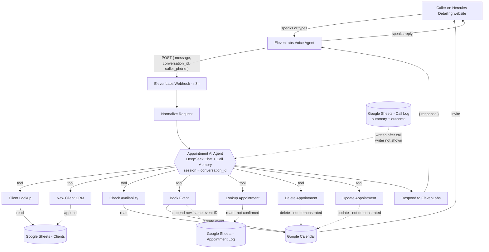

# Project Architecture — Hercules AI Receptionist

How the system is put together, how data flows through it, and how the integrations divide the work. Everything below is supported by the demonstration video; anything else is explicitly marked **"Not confirmed from video."**

---

## 1. Architecture Overview

The system has four layers:

```
┌─────────────────────────────────────────────────────────────────────┐
│ 1. PRESENTATION                                                     │
│    Hercules Detailing website                                       │
│    Service catalogue (services + durations) · Receptionist widget   │
│    "Start talking" voice UI + typed input + quick-phrase chips      │
└──────────────────────────────┬──────────────────────────────────────┘
                               │ caller speaks / types
                               ▼
┌─────────────────────────────────────────────────────────────────────┐
│ 2. VOICE LAYER — ElevenLabs                                         │
│    Conversational agent: speech-to-text, turn-taking, text-to-      │
│    speech. Forwards each caller message to the n8n webhook and      │
│    speaks the returned { response }.                                │
└──────────────────────────────┬──────────────────────────────────────┘
                               │ HTTP  { message, conversation_id, caller_phone }
                               ▼
┌─────────────────────────────────────────────────────────────────────┐
│ 3. ORCHESTRATION — n8n                                              │
│    Workflow: "ElevenLabs Receptionist (AI Agent)" (Published)       │
│    Webhook → Normalize Request → AI Agent → Respond to Webhook      │
│    AI Agent: DeepSeek Chat model + Call Memory (per-call session)   │
│    7 tool sub-workflows (Execute Workflow tools)                    │
└──────────────────────────────┬──────────────────────────────────────┘
                               │ tool calls
                               ▼
┌─────────────────────────────────────────────────────────────────────┐
│ 4. DATA LAYER                                                       │
│    Google Calendar — live availability + appointment events         │
│    Google Sheets "Hercules Detailing CRM"                           │
│      Clients · Appointment Log · Call Log                           │
└─────────────────────────────────────────────────────────────────────┘
```

### Design principles visible in the build

- **Thin main workflow, fat tools.** The main workflow is only four nodes. All business operations live in dedicated sub-workflows, so each capability (lookup, register, book, …) can be maintained and tested independently.
- **The agent decides, tools execute.** The LLM (DeepSeek Chat) never touches Google APIs directly — it calls n8n sub-workflows, which perform deterministic reads/writes.
- **One ID across systems.** The Google Calendar event ID is also written into the Sheets Appointment Log, linking the two data stores record-for-record.
- **Memory is scoped to the call.** Call Memory is keyed by `conversation_id`, so context persists across the turns of one conversation without leaking between callers.
- **Availability before promises.** The agent checks the real calendar before offering a slot (demonstrated in execution #51 → #54 sequence).

---

## 2. Data Flow

### 2.1 Per-turn flow (every caller message)

1. Caller speaks (or types) in the widget → ElevenLabs transcribes and sends `{ message, conversation_id, caller_phone }` to the **ElevenLabs Webhook**.
2. **Normalize Request** standardises the payload for the agent.
3. **Appointment AI Agent** loads the call's history from **Call Memory** (session = `conversation_id`), reasons with **DeepSeek Chat**, and either:
   - replies directly (e.g. asking for the caller's name and phone), or
   - calls one or more **tool sub-workflows** first, then replies using their results.
4. **Respond to ElevenLabs** returns `{ response }`; ElevenLabs speaks it. The turn ends; memory retains the updated context for the next turn.

### 2.2 Booking flow (demonstrated end-to-end)

```
Caller request (service + day/time + email)
   │
   ├─▶ Client Lookup ─────────────▶ Sheets: Clients (read by email)
   │        └─ result: "This is a new client"
   │
   ├─▶ (agent asks name + phone)
   │
   ├─▶ New Client CRM ────────────▶ Sheets: Clients (append row)
   ├─▶ Check Availability ────────▶ Calendar: read 2026-10-22 10:00–12:00 +05:00
   │        └─ result: slot free → agent offers the slot
   │
   ├─▶ (caller confirms)
   │
   └─▶ Book Event ─┬─▶ Calendar: create event "Full Detail – Sam Carter"
                   │    Thu 22 Oct 2026 10:00–12:00 PKT · attendee = client · confirmed
                   └─▶ Sheets: Appointment Log (append row, same event ID)

Call Log: Sheets row written with date, call summary, outcome "Booked"
   (the writing step is not shown — Not confirmed from video)
```

### 2.3 Data created by one booking (as seen in the video)

| Record | Store | Key fields shown |
|---|---|---|
| Client | Sheets · `Clients` | Email · Name · Phone |
| Appointment | Google Calendar event | Title "Full Detail – Sam Carter" · Thu 22 Oct 2026 10:00–12:00 (PKT) · attendee = client email · status confirmed · event ID |
| Appointment log row | Sheets · `Appointment Log` | ID (= calendar event ID) · Email · Appointment Type · Date (`2026-10-22T10:00:00+05:00`) · Notes |
| Call record | Sheets · `Call Log` | Date (`2026-10-20 10:04 PM`) · Summary · Outcome (`Booked`) |

---

## 3. Integration Overview

| Integration | Direction | What passes between them | Evidence |
|---|---|---|---|
| Website widget ↔ ElevenLabs | Bidirectional | Voice/text conversation; widget offers "Start talking", typed input, and quick phrases ("Book a full detail", "What's free tomorrow?", "Reschedule", "Cancel") | Section 01 |
| ElevenLabs → n8n | Request/response (webhook) | In: `{ message, conversation_id, caller_phone }` · Out: `{ response }` | Section 02 annotations |
| n8n AI Agent ↔ DeepSeek | API (chat model node) | Conversation + tool definitions; reasoning and tool selection | Canvas + executions footer ("Model: DeepSeek Chat") |
| n8n tools ↔ Google Sheets | Read/write | Clients lookup/insert; Appointment Log append; Call Log entries | Sections 02–03 |
| n8n tools ↔ Google Calendar | Read/write | Availability reads; event create (update/delete tools exist, not demonstrated) | Sections 02–03 |
| Google Calendar → Client | Notification | Calendar invite sent to the client's email (stated in the agent's confirmation message) | Section 03 conversation |

Authentication details for every integration (OAuth vs API key, account used) are **Not confirmed from video** — no credential screens are shown, and none are reproduced in this documentation.

---

## 4. Mermaid Flowchart



Solid lines = demonstrated in the video. Dotted lines = supported by the canvas/widget but the exact path is **Not confirmed from video** or **not demonstrated**.

---

## 5. Component Responsibilities

| Component | Responsibility | Does NOT do |
|---|---|---|
| Website + widget | Present services; capture voice/text input | Any booking logic |
| ElevenLabs agent | Speech in/out; session handling (`conversation_id`) | Calendar or CRM access |
| n8n main workflow | Transport + normalisation + response framing | Business logic (delegated to the agent + tools) |
| AI Agent (DeepSeek) | Intent understanding, dialogue, tool selection | Direct API calls to Google |
| Tool sub-workflows | Deterministic reads/writes on Calendar & Sheets | Conversation |
| Google Calendar | Source of truth for availability and appointments | Client records |
| Google Sheets CRM | Source of truth for clients, appointment log, call log | Live availability |

---

## 6. Architectural Notes & Open Questions

- **Synchronous design:** the webhook chain ends in a Respond to Webhook node, so ElevenLabs receives the reply within the same request. Observed execution times in the demo: 3.7s–6.5s per turn.
- **Idempotency / double-booking protection:** **Not confirmed from video.** Availability is checked in the same conversation shortly before booking, but no locking mechanism is shown.
- **Error handling:** no error paths, retries, or fallback workflows are visible in the video — **Not confirmed from video.**
- **Hosting:** the video shows the n8n editor but not how n8n itself is hosted (cloud vs self-hosted) — **Not confirmed from video.**
- **Call Log writer:** the Call Log is populated after the booking call, but which workflow/node writes it is never shown — **Not confirmed from video.**

---

*See also: [WORKFLOW-EXPLANATION.md](WORKFLOW-EXPLANATION.md) for node-by-node detail, [SETUP-GUIDE.md](SETUP-GUIDE.md) for recreation steps, and [PROJECT-LIMITATIONS.md](PROJECT-LIMITATIONS.md) for the evidence policy.*
