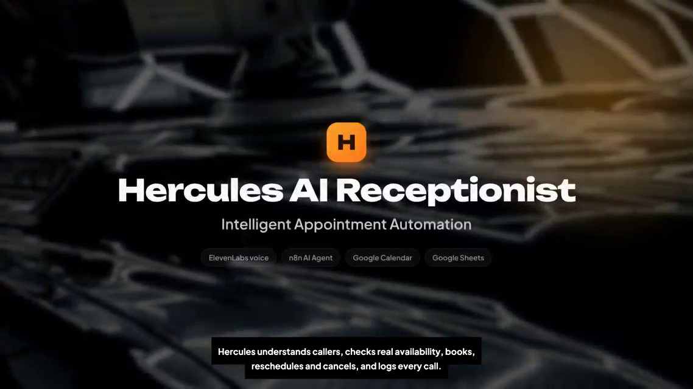
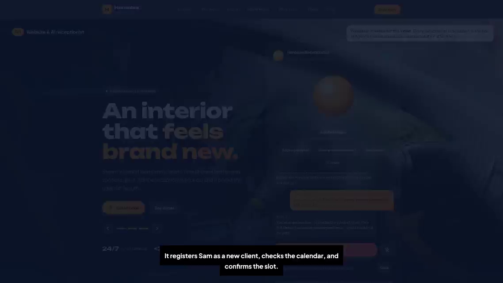
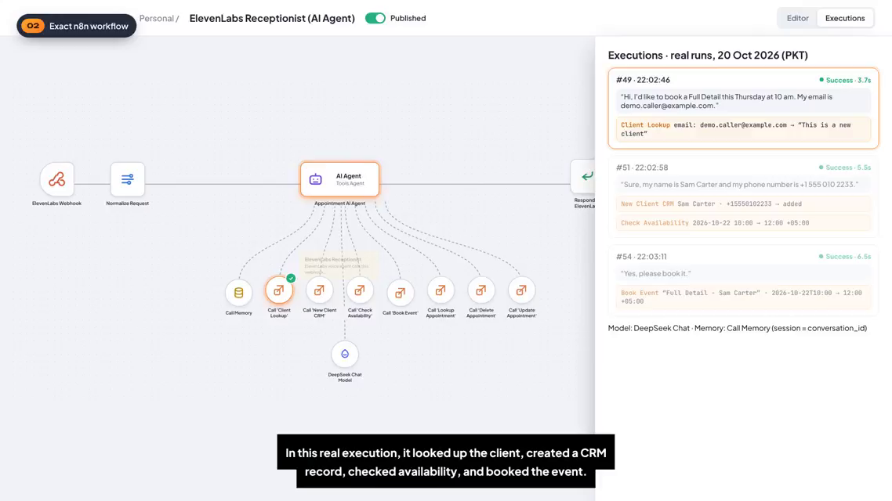

# Hercules AI Receptionist — Intelligent Appointment Automation



An AI voice receptionist for **Hercules Detailing** (a car detailing business) that answers customers through a website voice widget, understands what they need, checks the **real** calendar, and books, reschedules, or cancels appointments — writing every result to Google Calendar and a Google Sheets CRM, around the clock.

The voice layer is **ElevenLabs**; the brain is an **n8n AI Agent** (Tools Agent) powered by a **DeepSeek** chat model, with per-call memory and seven tool sub-workflows that read and write **Google Calendar** and **Google Sheets**.

> 📹 **Demo video:** [Watch on LinkedIn](https://lnkd.in/p/dndJ3Rxi) — see [demo/VIDEO-LINK.md](demo/VIDEO-LINK.md) for the full walkthrough this documentation is based on.
> ⚠️ This repository is a **documentation portfolio piece**. It is based solely on the demonstration video listed above. See [PROJECT-LIMITATIONS.md](PROJECT-LIMITATIONS.md) for exactly what is and is not verifiable.

---

## Table of Contents

- [Project Overview](#project-overview)
- [Business Problem](#business-problem)
- [Solution](#solution)
- [Key Features](#key-features)
- [Technologies Used](#technologies-used)
- [Workflow Architecture](#workflow-architecture)
- [Step-by-Step: How a Booking Happens](#step-by-step-how-a-booking-happens)
- [Screenshots](#screenshots)
- [Setup Summary](#setup-summary)
- [Use Cases](#use-cases)
- [Limitations](#limitations)
- [Future Improvements](#future-improvements)
- [Author](#author)

---

## Project Overview

| | |
|---|---|
| **Project** | Hercules AI Receptionist |
| **Business** | Hercules Detailing — car detailing studio |
| **Type** | Voice AI receptionist + workflow automation |
| **Core platform** | n8n (AI Agent workflow, published) |
| **Voice layer** | ElevenLabs conversational agent (website widget) |
| **AI model** | DeepSeek Chat (via n8n DeepSeek Chat Model node) |
| **Data layer** | Google Calendar (availability & events) + Google Sheets (CRM) |
| **Availability** | 24/7 — bookings in under 2 minutes, per the demo website |

Customers talk (or type) to the "Hercules Receptionist" widget on the business website. Each message is sent to an n8n webhook. An AI Agent decides what to do — look the client up, register a new client, check availability, book, find, change, or cancel an appointment — by calling dedicated sub-workflows as tools. The agent's reply is returned to ElevenLabs, which speaks it back to the caller.

## Business Problem

A small detailing studio loses bookings when nobody can answer:

- Calls and messages arrive **after hours**, when no receptionist is working.
- Answering the phone interrupts detailing work — jobs like paint correction take 4–8 hours of focused labour.
- Manual booking is error-prone: availability is checked by eye, details are re-typed into a calendar, and follow-up records are inconsistent.
- New customers have to be registered before they can be booked, adding friction to every first call.

## Solution

Replace the front desk with an always-on AI receptionist that behaves like a trained staff member:

1. **Greets and understands** the caller through the ElevenLabs voice widget (typing is also supported).
2. **Identifies the client** — looks the caller up in the CRM by email; if they are new, collects name and phone and registers them.
3. **Checks real availability** against Google Calendar before offering any slot — it never invents a free time.
4. **Books the appointment** as a Google Calendar event and logs it in the CRM in the same step, so the calendar and the records can never drift apart.
5. **Logs every call** with a summary and an outcome (e.g. "Booked") for the owner to review.

## Key Features

| Feature | Evidence in demo |
|---|---|
| 24/7 voice booking via website widget ("Start talking" or typed input) | ✅ Demonstrated |
| Natural conversation with per-call memory (session = `conversation_id`) | ✅ Demonstrated |
| Client lookup in CRM before booking | ✅ Demonstrated (execution #49) |
| New-client registration mid-conversation | ✅ Demonstrated (execution #51) |
| Real-time availability check against Google Calendar | ✅ Demonstrated (execution #51) |
| Booking written to Calendar **and** Sheets Appointment Log with a shared event ID | ✅ Demonstrated (execution #54) |
| Calendar invite sent to the client | ✅ Stated by the agent in the live reply |
| Call logging with summary + outcome | ✅ Demonstrated (Call Log tab) |
| Reschedule an existing appointment | 🛠 Supported by the `Update Appointment` tool and widget tagline — **not demonstrated end-to-end in the video** |
| Cancel an existing appointment | 🛠 Supported by the `Delete Appointment` tool and widget tagline — **not demonstrated end-to-end in the video** |

## Technologies Used

| Component | Technology | Role |
|---|---|---|
| Voice interface | ElevenLabs conversational agent | Speech in/out; website receptionist widget |
| Automation platform | n8n | Hosts the agent workflow and all tool sub-workflows |
| Agent framework | n8n AI Agent node (Tools Agent) | Decides which tool to call for each request |
| Language model | DeepSeek Chat | Conversation reasoning and tool selection |
| Agent memory | n8n memory node ("Call Memory") | Keeps context per call, keyed by `conversation_id` |
| Scheduling | Google Calendar | Live availability and appointment events |
| CRM / logging | Google Sheets ("Hercules Detailing CRM") | `Clients`, `Appointment Log`, and `Call Log` tabs |
| Front end | Hercules Detailing website | Service catalogue, prices/durations, receptionist widget |

## Workflow Architecture

The main workflow — **"ElevenLabs Receptionist (AI Agent)"** — is a four-node chain with the agent in the middle:

```
ElevenLabs widget ──▶ ElevenLabs Webhook ──▶ Normalize Request ──▶ Appointment AI Agent ──▶ Respond to ElevenLabs ──▶ ElevenLabs speaks
                                                                          │
                                          ┌───────────────────────────────┼───────────────────────────────┐
                                          │  Tools (n8n sub-workflows)                                     │
                                          │  Client Lookup · New Client CRM · Check Availability           │
                                          │  Book Event · Lookup Appointment · Delete Appointment          │
                                          │  Update Appointment                                                │
                                          └──────────────┬──────────────────────────────┬───────────────────┘
                                                         ▼                              ▼
                                                Google Sheets CRM               Google Calendar
                                          (Clients / Appointment Log /      (availability & events)
                                                 Call Log)
```

The webhook receives `{ message, conversation_id, caller_phone }`; the workflow returns `{ response }`, which ElevenLabs speaks to the caller. Full detail: [WORKFLOW-EXPLANATION.md](WORKFLOW-EXPLANATION.md) and [PROJECT-ARCHITECTURE.md](PROJECT-ARCHITECTURE.md).



## Step-by-Step: How a Booking Happens

This is the exact flow demonstrated in the video (n8n executions #49, #51, #54 — 20 Oct 2026, PKT):

1. **Request.** The caller asks to book a *Full Detail* on Thursday at 10 am and gives a demo email address.
2. **Client lookup (execution #49, 3.7s).** The agent calls **Client Lookup** — the email is not in the CRM: *"This is a new client."*
3. **Registration.** The agent asks for a full name and phone number. The caller provides them (demo client "Sam Carter").
4. **New client + availability (execution #51, 5.5s).** The agent calls **New Client CRM** to add the client, then **Check Availability** for Thursday 2026-10-22, 10:00–12:00 (+05:00).
5. **Offer.** The agent confirms the slot is free, states the service runs until noon, and asks *"Shall I book that for you?"*
6. **Booking (execution #54, 6.5s).** The caller confirms. **Book Event** creates the Google Calendar event *"Full Detail – Sam Carter"* (Thu 22 Oct 2026, 10:00–12:00 PKT) and appends the matching row to the Appointment Log — both records carry the **same event ID**. A calendar invite is sent to the client.
7. **Call log.** The call is written to the Call Log with date, summary, and outcome **"Booked"**.



## Screenshots

| Asset | What it shows | Source |
|---|---|---|
| `assets/project-demo-thumbnail.png` | Project title card — "Hercules AI Receptionist · Intelligent Appointment Automation" | Video, ~01:27 |
| `assets/workflow-overview.png` | The exact n8n workflow canvas: webhook → normalize → AI Agent → respond, with memory, DeepSeek model, and all seven tools | Video, ~00:26 |
| `assets/execution-result.png` | Real executions #49 / #51 / #54 with the tools each run called | Video, ~00:50 |

More timestamps and a full scene-by-scene guide: [demo/VIDEO-LINK.md](demo/VIDEO-LINK.md).

## Setup Summary

You need: an **n8n** instance, an **ElevenLabs** conversational agent connected to the n8n webhook, a **DeepSeek** API credential for the chat model, and **Google** credentials for Calendar and Sheets, plus a spreadsheet with `Clients`, `Appointment Log`, and `Call Log` tabs.

Full instructions, clearly separated into *verified from the video* vs *suggested reconstruction*: [SETUP-GUIDE.md](SETUP-GUIDE.md).

## Use Cases

- **After-hours booking capture** — the studio takes bookings at 2 am as easily as at 2 pm.
- **Hands-free front desk** — detailers keep working while the receptionist handles enquiries.
- **First-time client onboarding** — new customers are registered in the CRM during their first conversation, no forms.
- **Consistent records** — every appointment exists in both the calendar and the CRM log, linked by one event ID; every call leaves a summary.
- **Repeatable pattern** — the same architecture fits any appointment-based business (clinics, salons, workshops, rentals) by swapping the service list and calendar.

## Limitations

- This documentation is reconstructed **from the demo video only** — the original n8n workflow JSON export is not included and no live deployment link is available. See [PROJECT-LIMITATIONS.md](PROJECT-LIMITATIONS.md).
- Only the **booking** journey is demonstrated end-to-end. Reschedule and cancel are supported by dedicated tools and the product tagline, but are **not shown** in the video.
- Internal details not visible on screen (agent system prompt, exact node parameters, credential setup) are marked **"Not confirmed from video"** wherever they come up.

## Future Improvements

*Suggested directions — none of these are shown in the video:*

- Demonstrate the reschedule and cancel journeys end-to-end (tools already exist).
- Add reminder messages before appointments to reduce no-shows.
- Offer the caller's language of choice through the voice layer.
- Add a human hand-off path for requests the agent cannot resolve.
- Publish the workflow JSON export alongside this documentation for full reproducibility.

## Author

**Fahad Ahmed Shanawar**
AI Engineer — Agentic AI · n8n Automation · Voice AI

- GitHub: https://github.com/AiwithFahad
- LinkedIn: https://www.linkedin.com/in/fahad-ahmed-shanawar-107a5535a/

---

*Documentation generated from the project's demonstration video. Claims in this repository are limited to what the video shows; see [PROJECT-LIMITATIONS.md](PROJECT-LIMITATIONS.md).*
